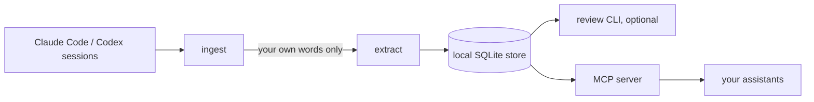

# PersonaKit

Memory for your AI assistants that **you** can read, correct and take with you.

PersonaKit reads the conversations you already have with your assistants, proposes short
memories ("you prefer direct, practical feedback"), keeps the exact quote each one came from,
and serves only what you allow back to your assistants over MCP. Everything runs on your own
machine. There is no PersonaKit server and no account.

> **Status: pre-release (0.1 in progress).** This repository is being built in public.
> See [docs/ROADMAP.md](docs/ROADMAP.md) for what exists and what is planned.

## How it works

1. **Ingest** reads local session files. Only the turns you wrote leave the parsing step.
2. **Extract** asks a model you already use (your own CLI login or API key) to propose memories.
3. **Store** keeps each memory with its source quote, a state, and a scope.
4. **Review** is optional. Memories you never review are served marked *unconfirmed*; you
   can approve, edit, restrict or remove any of them at any time.
5. **Serve** exposes the store to assistants over MCP, with the evidence attached.

Read [docs/ARCHITECTURE.md](docs/ARCHITECTURE.md) for the design and
[docs/PRIVACY.md](docs/PRIVACY.md) for exactly what is sent where.

## License

Apache-2.0. See [LICENSE](LICENSE).
