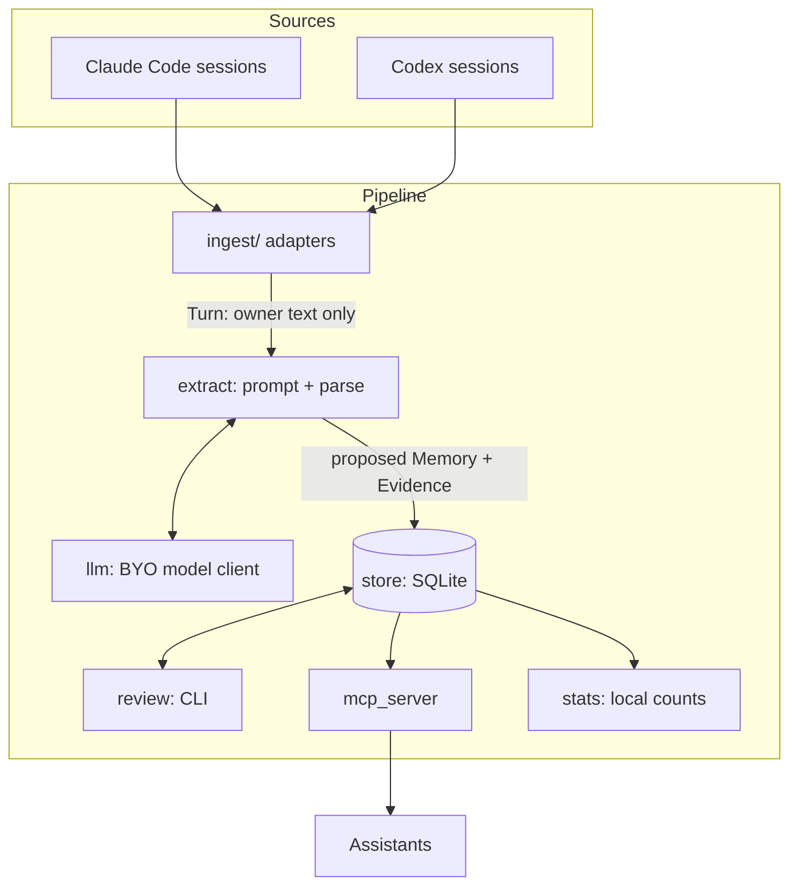

# Architecture (v0.1 design)

PersonaKit is a small local pipeline with one database. Each stage has one job and talks to
the next only through the store.

## Modules

| Module | Responsibility | Depends on |
|---|---|---|
| `model` | Plain data types: `Turn`, `Session`, `Memory`, `Evidence`, `State`, `Decider`. No I/O. | nothing |
| `ingest/` | One adapter per source (`claude_code`, `codex`) plus `common` for the rules they share. Reads a session file, returns the owner's `Turn`s with a count of what was dropped and why. | `model` |
| `llm` | One interface, `complete(prompt) -> str`, implemented by two CLI-backed clients (`claude`, `codex`). The per-run call budget lives here. | nothing |
| `extract` | Builds the prompt from owner turns, validates the reply into `Memory` + `Evidence`, and counts what it rejects and why. | `model`, `llm` |
| `sweep` | Runs ingest, extract and store over new sessions. Skips unchanged files, stops only on budget or model error, never because unreviewed memories are piling up. | `ingest`, `extract`, `llm`, `store` |
| `retrieve` | The one read policy: approved and unconfirmed memories are served, restricted and archived never are. It also shapes the evidence quotes an assistant receives (email addresses masked, cut at a word boundary). Word-overlap ranking, a baseline to be measured. | `model` |
| `store` | The only module that touches SQLite. Schema, migrations, queries, state changes. | `model` |
| `review` | Terminal UI over the store: approve, restrict, hide, forget. Optional by design. | `store` |
| `mcp_server` | Two tools for assistants: `personakit_read` and `personakit_propose`. Holds no read-policy constants of its own. Assistants cannot approve, restrict, hide or forget; only the owner can, in `review`. | `store`, `retrieve`, `extract` |
| `stats` | Counts only (memories by state, sessions extracted, reads and how many returned something). Never content. | `store` |
| `cli` | Argument parsing and wiring; no logic. | all |

One rule keeps the layering honest: **only `store` imports `sqlite3`, only `llm` talks to a
model, only `ingest` reads session files.** A second implementation of any of those is a bug.

## Data model

- **Turn**: `(source, session_id, index, timestamp, text)`. Only owner-authored turns exist here.
- **Memory**: `id, text, category, scope, state, created_at, decided_at, decided_by`.
- **Evidence**: `memory_id, session_id, turn_index, quote`. Every memory has at least one.
- **State**: `unconfirmed` (default, served with a label) -> `approved` | `restricted` |
  `archived`. Nothing is ever hard-deleted without an explicit `forget` by the owner.

## Policy

1. A memory with no evidence is not stored.
2. Unconfirmed memories are served, labelled as unconfirmed. Review is a quality tool, not a gate.
3. The system never changes a memory's state or deletes a memory on its own. Extracting the same
   statement again adds evidence to the existing memory and leaves your decision alone. Merging
   near-duplicates and archiving stale items are planned for 0.2 and will be reversible.
4. Only text the owner wrote is sent to a model.
5. Statistics are counts, never content, and are local unless the owner chooses to share them.

## Out of scope for 0.1

Hosted service, accounts, sync, ChatGPT/Gemini/claude.ai import, embeddings, third-party name
detection, autonomous curation. Each is planned as an optional module; see the roadmap.
