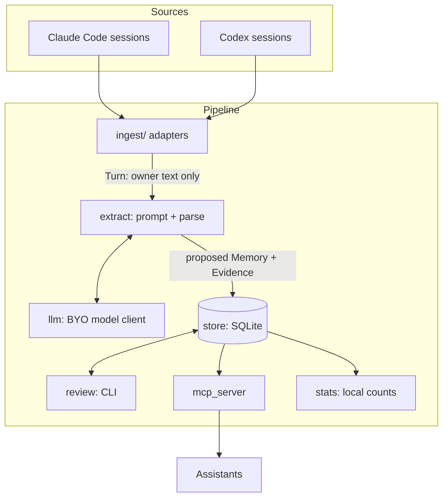

# Architecture (v0.1 design)

PersonaKit is a small local pipeline with one database. Each stage has one job and talks to
the next only through the store.

## Modules

| Module | Responsibility | Depends on |
|---|---|---|
| `model` | Plain data types: `Turn`, `Memory`, `Evidence`, `State`, `Scope`. No I/O. | nothing |
| `ingest/` | One adapter per source (`claude_code`, `codex`) plus `common` for the rules they share. Reads a session file, returns the owner's `Turn`s with a count of what was dropped and why. | `model` |
| `llm` | One interface, `complete(prompt) -> str`, with a CLI-backed and an API-backed implementation. Spend cap lives here. | nothing |
| `extract` | Builds the prompt from owner turns, parses and validates the reply into `Memory` + `Evidence`. | `model`, `llm` |
| `store` | The only module that touches SQLite. Schema, migrations, queries, state changes. | `model` |
| `review` | Terminal UI over the store: approve, edit, restrict, remove. Optional by design. | `store` |
| `mcp_server` | Read/propose/decide tools for assistants. Reads through the same policy as `review`. | `store` |
| `stats` | Counts only (memories, states, reads). Never content. | `store` |
| `cli` | Argument parsing and wiring; no logic. | all |

One rule keeps the layering honest: **only `store` imports `sqlite3`, only `llm` talks to a
model, only `ingest` reads session files.** A second implementation of any of those is a bug.

## Data model

- **Turn**: `(source, session_id, index, timestamp, text)`. Only owner-authored turns exist here.
- **Memory**: `id, text, category, scope, state, created_at, decided_at, decided_by`.
- **Evidence**: `memory_id, session_id, turn_index, quote`. Every memory has at least one.
- **State**: `unconfirmed` (default, served with a label) -> `approved` | `restricted` |
  `archived`. Nothing is ever hard-deleted without an explicit `forget` by the owner.

## Policy

1. A memory with no evidence is not stored.
2. Unconfirmed memories are served, labelled as unconfirmed. Review is a quality tool, not a gate.
3. The system may merge duplicates and archive stale items (reversible). It never deletes or
   widens a scope on its own.
4. Only text the owner wrote is sent to a model.
5. Statistics are counts, never content, and are local unless the owner chooses to share them.

## Out of scope for 0.1

Hosted service, accounts, sync, ChatGPT/Gemini/claude.ai import, embeddings, third-party name
detection, autonomous curation. Each is planned as an optional module; see the roadmap.
