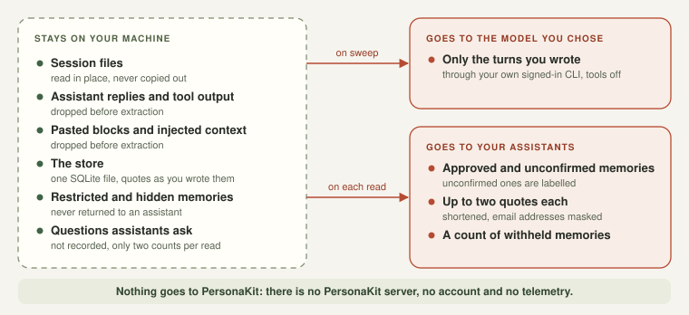

# Privacy

  

- **Where data lives:** a SQLite file on your machine. Nothing is uploaded by PersonaKit.
- **What a model sees:** extraction sends only the turns *you* wrote, to the model you
  name, through your own signed-in `claude` or `codex` CLI, under that provider's terms. Assistant replies,
  tool output and file contents from sessions are not sent.
- **What assistants see:** only what the MCP server returns. Restricted and archived
  memories are never returned; unconfirmed ones are labelled. The evidence quotes it returns are shortened to a word boundary and email
  addresses in them are masked; the store itself keeps the quote as you wrote it.
- **Read log:** each read stores the time and two counts (returned, withheld) in your local
  store. The question and the memory text are not recorded.
- **Statistics:** `personakit stats` prints counts to your terminal. It never includes memory text.
  Sharing the output is your choice.
- **Deletion:** `personakit forget` removes a memory and its evidence from the store.
- **Tidy and undo:** `personakit tidy` reads your store and, only with `--apply`, folds
  near-identical memories together and archives stale ones. A merged memory is kept inside your
  store, as a record that lets `personakit undo` restore it; the record is emptied on undo and
  deleted when you `forget` the memory it was merged into (or the merged memory itself). Nothing
  leaves your machine, and nothing here calls a model.
- **Digest:** `personakit digest` prints memory ids and text (never evidence quotes) to your
  terminal. Unlike `stats` it is not counts-only, so look before pasting it anywhere.
