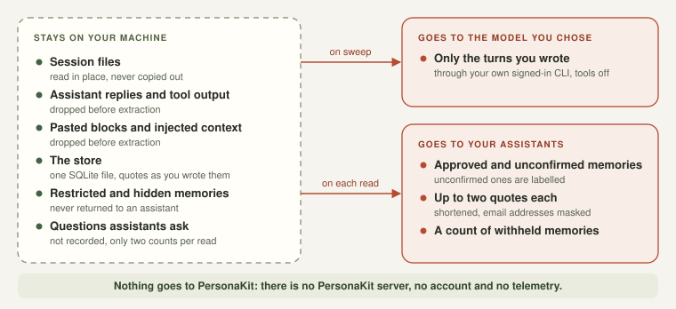

# Privacy

  

- **Where data lives:** a SQLite file on your machine. Nothing is uploaded by PersonaKit.
- **What a model sees:** extraction sends only the turns *you* wrote, to the model you
  name, through your own signed-in `claude` or `codex` CLI, under that provider's terms. Assistant replies,
  tool output and file contents from sessions are not sent.
- **What assistants see:** only what the MCP server returns. Restricted and archived
  memories are never returned; unconfirmed ones are labelled. Only memories relevant to the
  assistant's question, or to what it says it is about to do, are returned. Evidence quotes are
  returned only when the assistant asks for them; they are shortened to a word boundary and email
  addresses in them are masked; the store itself keeps the quote as you wrote it. The hints you add
  with `personakit hints` help ranking and are never returned.
- **Read log:** each read stores the time and two counts (returned, withheld) in your local
  store. The question, the assistant's stated context and the memory text are not recorded. The
  server remembers which memory ids it has already sent, in memory only, until it stops.
- **Statistics:** `personakit stats` prints counts to your terminal. It never includes memory text.
  Sharing the output is your choice.
- **Deletion:** `personakit forget` removes a memory and its evidence from the store.
- **Tidy and undo:** `personakit tidy` reads your store and, only with `--apply`, folds
  near-identical memories together and archives stale ones. A folded memory stays in your store
  with its own quotes, so `personakit undo` restores it exactly. `personakit forget` on a folded
  memory deletes it and every quote it brought; `forget` on the memory it was folded into deletes
  both, since they are the same statement. Nothing leaves your machine, and nothing here calls a
  model. Assistants cannot merge, undo, archive or restore.
- **Digest:** `personakit digest` prints memory ids and text (never evidence quotes) to your
  terminal. Unlike `stats` it is not counts-only, so look before pasting it anywhere.
- **Plugins:** none are loaded unless you name them in `PERSONAKIT_PLUGINS`. A plugin replaces
  how relevance or similarity is scored, or narrows a read to fewer of the memories the core already allows, and cannot widen
  what is served or what may be merged, but it is code you installed, running as you. A `select` plugin receives the text of
  the memories it is offered and may send it wherever its code does: check what yours does before enabling it. What it does with your data is up to that plugin; read it first.
